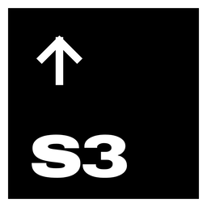
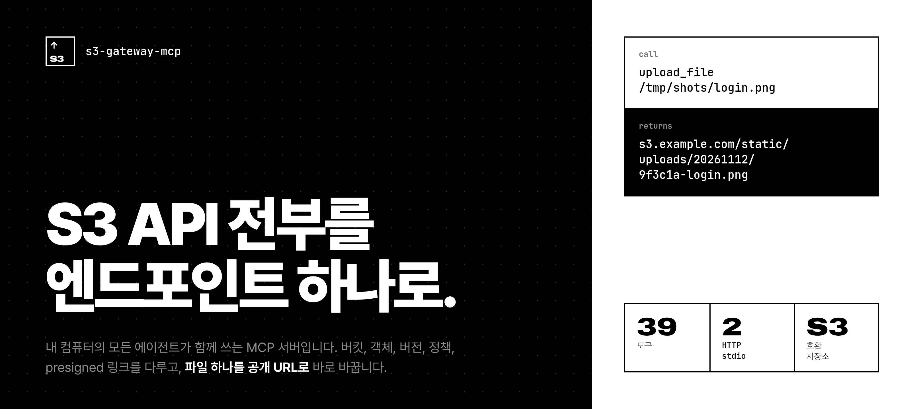
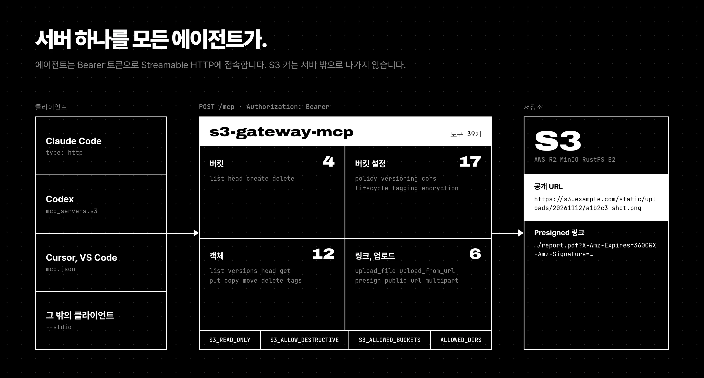
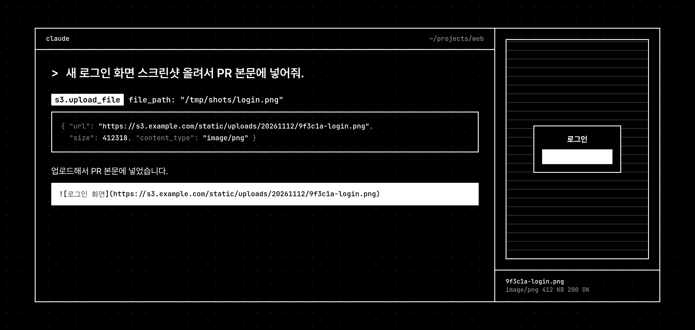

<p align="center">
  
</p>

<p align="center"><a href="README.md">English</a> · <b>한국어</b></p>



# s3-gateway-mcp

S3 호환 저장소를 다루는 MCP 서버입니다. **Streamable HTTP** 서비스로 한 번 띄워 두면 Claude Code, Codex, Cursor 같은 에이전트가 모두 같은 서버를 씁니다. 프로세스 하나만 쓰고 싶으면 **stdio** 모드로도 실행할 수 있습니다.

- 버킷, 객체, 버전, 정책, CORS, 수명주기, 태그, 암호화, presigned URL, 멀티파트 정리까지 **도구 39개**를 제공합니다.
- `upload_file`에 로컬 경로를 넘기면 **공개 URL**이 바로 나옵니다. PR이나 이슈에 그대로 붙이면 됩니다.
- S3 키는 서버에만 둡니다. 클라이언트는 Bearer 토큰만 가집니다.
- AWS S3, Cloudflare R2, MinIO, RustFS, Backblaze B2, Wasabi, DigitalOcean Spaces 등 S3 API를 지원하는 곳이면 어디든 연결됩니다.



## 시작하기

### Docker (권장)

이미지를 빌드한 뒤, 설정을 환경변수로 넣어 실행합니다.

```bash
git clone https://github.com/jdk1021/s3-gateway-mcp.git
docker build -t s3-gateway-mcp ./s3-gateway-mcp

docker run -d --name s3-gateway-mcp --restart unless-stopped \
  --user "$(id -u):$(id -g)" \
  -p 127.0.0.1:18801:8000 \
  -v "$HOME:$HOME:ro" -v /tmp:/tmp:ro \
  -e MCP_TOKEN="$(openssl rand -hex 32)" \
  -e S3_ENDPOINT=https://s3.example.com \
  -e S3_REGION=us-east-1 \
  -e S3_ACCESS_KEY_ID=your_key \
  -e S3_SECRET_ACCESS_KEY=your_secret \
  -e S3_BUCKET=static \
  -e S3_PUBLIC_URL=https://s3.example.com/static \
  -e S3_PATH_PREFIX=uploads/ \
  -e ALLOWED_DIRS="$HOME:/tmp" \
  s3-gateway-mcp

curl -s localhost:18801/health
docker exec s3-gateway-mcp printenv MCP_TOKEN    # 에이전트 등록에 쓸 토큰
```

`-v` 옵션은 홈 디렉터리와 `/tmp`를 **같은 경로에 읽기 전용으로** 마운트합니다. 그래서 에이전트가 호스트에서 보는 경로를 `upload_file`에 그대로 넘기면 됩니다. `ALLOWED_DIRS`는 이 마운트 경로와 맞춰 두세요. 전체 변수는 [설정](#설정)에 있습니다.

### Docker Compose

```bash
git clone https://github.com/jdk1021/s3-gateway-mcp.git && cd s3-gateway-mcp
cp env.example .env          # S3_* 값과 MCP_TOKEN을 채운다
docker compose up -d --build
```

### Node로 직접 실행

```bash
npm ci
MCP_TOKEN=... S3_ENDPOINT=... S3_ACCESS_KEY_ID=... S3_SECRET_ACCESS_KEY=... S3_BUCKET=... \
  node src/index.mjs            # HTTP :8000
node src/index.mjs --stdio      # stdio
```

Node.js 20 이상이 필요합니다.

## 에이전트 연결

**Claude Code**

```bash
claude mcp add --transport http -s user s3 http://localhost:18801/mcp \
  --header "Authorization: Bearer $MCP_TOKEN"
```

**Codex** (`~/.codex/config.toml`)

```toml
[mcp_servers.s3]
url = "http://localhost:18801/mcp"
http_headers = { Authorization = "Bearer <MCP_TOKEN>" }
```

**Cursor, VS Code 등** (`mcp.json`)

```json
{
  "mcpServers": {
    "s3": {
      "type": "http",
      "url": "http://localhost:18801/mcp",
      "headers": { "Authorization": "Bearer <MCP_TOKEN>" }
    }
  }
}
```

**stdio** (서버를 따로 띄우지 않을 때)

```bash
claude mcp add -s user s3 \
  -e S3_ENDPOINT=https://s3.example.com -e S3_ACCESS_KEY_ID=... -e S3_SECRET_ACCESS_KEY=... \
  -e S3_BUCKET=static -e S3_PUBLIC_URL=https://s3.example.com/static \
  -- node /path/to/s3-gateway-mcp/src/index.mjs --stdio
```



## 설정

| 변수 | 기본값 | 설명 |
|---|---|---|
| `MCP_TOKEN` | 없음 | Bearer 토큰. HTTP 모드에서는 반드시 넣어야 합니다. |
| `MCP_AUTH_DISABLED` | `false` | 인증을 끕니다. 믿을 수 있는 로컬 환경에서만 쓰세요. |
| `PORT` / `HOST` | `8000` / `0.0.0.0` | HTTP 수신 주소 |
| `S3_ENDPOINT` | AWS | 저장소 엔드포인트 URL |
| `S3_REGION` | `us-east-1` | 리전. R2는 `auto` |
| `S3_FORCE_PATH_STYLE` | `true` | 경로 방식 주소(MinIO, RustFS). AWS 가상 호스트 방식이면 `false` |
| `S3_ACCESS_KEY_ID` / `S3_SECRET_ACCESS_KEY` | 없음 | 접속 키(필수) |
| `S3_SESSION_TOKEN` | 없음 | 임시 자격증명 |
| `S3_BUCKET` | 없음 | 도구 호출에 `bucket`이 없을 때 쓰는 기본 버킷 |
| `S3_PUBLIC_URL` | 없음 | 기본 버킷의 공개 주소. `{bucket}`을 넣으면(예: `https://cdn.example.com/{bucket}`) 모든 버킷에 적용됩니다. |
| `S3_PATH_PREFIX` | 빈 값 | 자동 생성 업로드 키 앞에 붙는 경로(예: `uploads/`) |
| `S3_ALLOWED_BUCKETS` | 전체 | 허용할 버킷 목록(쉼표 구분) |
| `S3_READ_ONLY` | `false` | 읽기 도구만 등록합니다. PUT presign도 거부합니다. |
| `S3_ALLOW_DESTRUCTIVE` | `true` | `false`면 삭제·중단·이동 도구를 숨깁니다. |
| `ALLOWED_DIRS` | 현재 디렉터리 | `upload_file`이 읽을 수 있는 디렉터리(콜론 구분) |
| `DOWNLOAD_DIR` | 없음 | 설정하면 `get_object`의 `save_to`를 이 디렉터리 안에서만 허용합니다. |
| `MAX_UPLOAD_MB` | `100` | 업로드 크기 제한 |
| `MAX_INLINE_KB` | `1024` | `get_object`가 본문을 바로 돌려주는 최대 크기 |

`key`를 생략하면 `{S3_PATH_PREFIX}YYYYMMDD/<16진수 6자리>-<파일명>`으로 저장합니다. 원하는 경로가 있으면 `key`를 넘기세요.

## 도구

모든 도구는 `bucket`을 받고, 생략하면 `S3_BUCKET`을 씁니다. 도구마다 MCP `readOnlyHint`, `destructiveHint` 표시가 붙어 있어서, 클라이언트가 삭제 같은 작업 전에 확인을 받을 수 있습니다.

| 분류 | 도구 |
|---|---|
| 버킷 | `list_buckets` `head_bucket` `create_bucket` `delete_bucket` |
| 정책 | `get_bucket_policy` `put_bucket_policy` `delete_bucket_policy` |
| 버전 관리 | `get_bucket_versioning` `put_bucket_versioning` |
| CORS | `get_bucket_cors` `put_bucket_cors` `delete_bucket_cors` |
| 수명주기 | `get_bucket_lifecycle` `put_bucket_lifecycle` `delete_bucket_lifecycle` |
| 버킷 태그 | `get_bucket_tagging` `put_bucket_tagging` `delete_bucket_tagging` |
| 암호화 | `get_bucket_encryption` `put_bucket_encryption` `delete_bucket_encryption` |
| 객체 읽기 | `list_objects` `list_object_versions` `head_object` `get_object` |
| 객체 쓰기 | `put_object` `upload_file` `upload_from_url` `copy_object` `move_object` |
| 객체 삭제 | `delete_object` `delete_objects`(키 목록, 또는 prefix와 `confirm: true`) |
| 객체 태그 | `get_object_tagging` `put_object_tagging` `delete_object_tagging` |
| 링크 | `presign_url`(GET/PUT, 최대 7일) `get_public_url` |
| 멀티파트 | `list_multipart_uploads` `abort_multipart_upload` |

5MB를 넘는 업로드는 자동으로 멀티파트로 올라갑니다.

## 보안 참고

- `compose.yml`은 HTTP 포트를 `127.0.0.1`에만 엽니다. 다른 곳에 노출하려면 TLS 리버스 프록시를 앞에 두세요.
- 서버에는 필요한 버킷만 다룰 수 있는 키를 주고, `S3_ALLOWED_BUCKETS`, `S3_READ_ONLY`, `S3_ALLOW_DESTRUCTIVE=false`를 함께 쓰세요.
- `upload_file`은 심볼릭 링크를 실제 경로로 풀어서 확인하고, `ALLOWED_DIRS` 밖이면 거부합니다.
- `upload_from_url`은 내부망 주소를 포함해 받은 URL을 그대로 가져옵니다. 신뢰할 수 없는 프롬프트가 이 도구를 쓰지 않게 하세요.

## 디자인 원본

README 이미지는 [`design/`](design/)의 HTML을 Playwright로 캡처한 것입니다. 저장소 루트에서 `python3 -m http.server`를 띄우고 `/design/hero.html`을 열면 되고, 한국어판은 주소 뒤에 `?lang=ko`를 붙이면 됩니다.

## 라이선스

MIT
