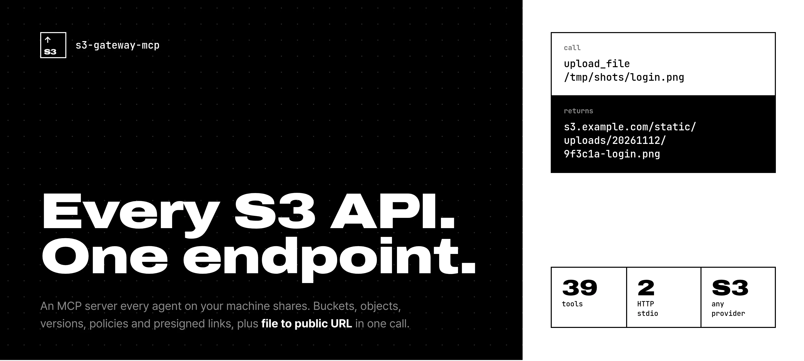
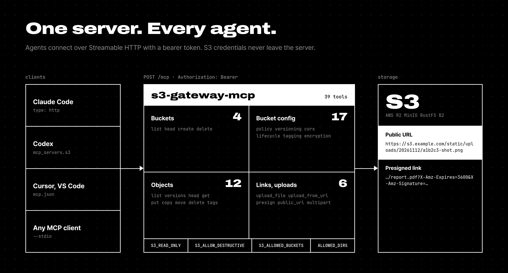
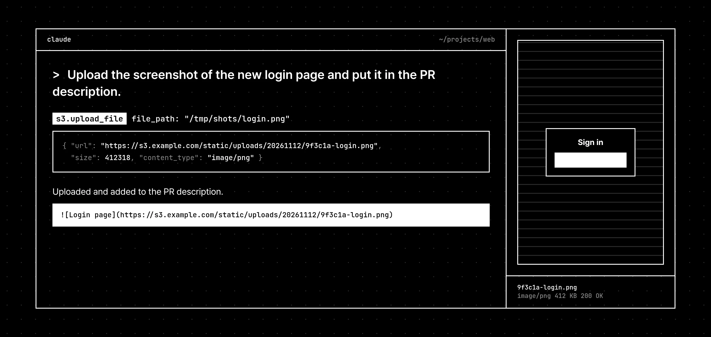

<p align="center">
  
</p>

<p align="center"><b>English</b> · <a href="README.ko.md">한국어</a></p>



# s3-gateway-mcp

An MCP server for S3-compatible storage. It runs once as a **Streamable HTTP** service, and every agent on your machine (Claude Code, Codex, Cursor, …) shares it. It also speaks **stdio** when you want a single local process.

- **39 tools** covering buckets, objects, versions, policies, CORS, lifecycle, tags, encryption, presigned URLs and multipart cleanup.
- **File → public URL in one call.** `upload_file` reads a local path and returns a link you can paste into a PR or issue.
- **Credentials stay on the server.** Clients only hold a bearer token.
- **Works with any S3 API:** AWS S3, Cloudflare R2, MinIO, RustFS, Backblaze B2, Wasabi, DigitalOcean Spaces.



## Quick start

### Docker (recommended)

```bash
git clone https://github.com/jdk1021/s3-gateway-mcp.git && cd s3-gateway-mcp
cp env.example .env          # fill in S3_* and MCP_TOKEN (openssl rand -hex 32)
docker compose up -d --build
curl -s localhost:18801/health
```

`compose.yml` mounts your home directory and `/tmp` **read-only at the same paths**, so a path an agent sees on the host is the path `upload_file` reads. Keep `ALLOWED_DIRS` in sync with those mounts.

### Node

```bash
npm ci
MCP_TOKEN=... S3_ENDPOINT=... S3_ACCESS_KEY_ID=... S3_SECRET_ACCESS_KEY=... S3_BUCKET=... \
  node src/index.mjs            # HTTP on :8000
node src/index.mjs --stdio      # or stdio
```

Requires Node.js 20 or later.

## Connect your agents

**Claude Code**

```bash
claude mcp add --transport http -s user s3 http://localhost:18801/mcp \
  --header "Authorization: Bearer $MCP_TOKEN"
```

**Codex** (`~/.codex/config.toml`)

```toml
[mcp_servers.s3]
url = "http://localhost:18801/mcp"
http_headers = { Authorization = "Bearer <MCP_TOKEN>" }
```

**Cursor / VS Code / other clients** (`mcp.json`)

```json
{
  "mcpServers": {
    "s3": {
      "type": "http",
      "url": "http://localhost:18801/mcp",
      "headers": { "Authorization": "Bearer <MCP_TOKEN>" }
    }
  }
}
```

**stdio** (no server to run)

```bash
claude mcp add -s user s3 \
  -e S3_ENDPOINT=https://s3.example.com -e S3_ACCESS_KEY_ID=... -e S3_SECRET_ACCESS_KEY=... \
  -e S3_BUCKET=static -e S3_PUBLIC_URL=https://s3.example.com/static \
  -- node /path/to/s3-gateway-mcp/src/index.mjs --stdio
```



## Configuration

| Variable | Default | Description |
|---|---|---|
| `MCP_TOKEN` | — | Bearer token. Required in HTTP mode. |
| `MCP_AUTH_DISABLED` | `false` | Turn off auth for trusted local setups only. |
| `PORT` / `HOST` | `8000` / `0.0.0.0` | HTTP listen address. |
| `S3_ENDPOINT` | AWS | Endpoint URL of your provider. |
| `S3_REGION` | `us-east-1` | Region. R2 uses `auto`. |
| `S3_FORCE_PATH_STYLE` | `true` | Path-style addressing (MinIO, RustFS). Set `false` for virtual-hosted AWS buckets. |
| `S3_ACCESS_KEY_ID` / `S3_SECRET_ACCESS_KEY` | — | Credentials. Required. |
| `S3_SESSION_TOKEN` | — | Temporary credentials. |
| `S3_BUCKET` | — | Default bucket when a tool call omits `bucket`. |
| `S3_PUBLIC_URL` | — | Public base URL of the default bucket. Use `{bucket}` (e.g. `https://cdn.example.com/{bucket}`) to cover all buckets. |
| `S3_PATH_PREFIX` | empty | Prefix for auto-generated upload keys, e.g. `uploads/`. |
| `S3_ALLOWED_BUCKETS` | all | Comma-separated allowlist. |
| `S3_READ_ONLY` | `false` | Register read tools only. PUT presigning is also refused. |
| `S3_ALLOW_DESTRUCTIVE` | `true` | `false` hides every delete/abort/move tool. |
| `ALLOWED_DIRS` | cwd | Colon-separated directories `upload_file` may read. |
| `DOWNLOAD_DIR` | — | Enables `get_object` `save_to`, restricted to this directory. |
| `MAX_UPLOAD_MB` | `100` | Upload size limit. |
| `MAX_INLINE_KB` | `1024` | Largest object `get_object` returns inline. |

Without a `key`, uploads are stored as `{S3_PATH_PREFIX}YYYYMMDD/<6 hex>-<filename>`. Pass `key` to choose the exact path.

## Tools

Every tool takes an optional `bucket` that falls back to `S3_BUCKET`. Tools carry MCP `readOnlyHint` / `destructiveHint` annotations so clients can ask before destructive calls.

| Group | Tools |
|---|---|
| Buckets | `list_buckets` `head_bucket` `create_bucket` `delete_bucket` |
| Policy | `get_bucket_policy` `put_bucket_policy` `delete_bucket_policy` |
| Versioning | `get_bucket_versioning` `put_bucket_versioning` |
| CORS | `get_bucket_cors` `put_bucket_cors` `delete_bucket_cors` |
| Lifecycle | `get_bucket_lifecycle` `put_bucket_lifecycle` `delete_bucket_lifecycle` |
| Bucket tags | `get_bucket_tagging` `put_bucket_tagging` `delete_bucket_tagging` |
| Encryption | `get_bucket_encryption` `put_bucket_encryption` `delete_bucket_encryption` |
| Read objects | `list_objects` `list_object_versions` `head_object` `get_object` |
| Write objects | `put_object` `upload_file` `upload_from_url` `copy_object` `move_object` |
| Delete objects | `delete_object` `delete_objects` (keys, or prefix with `confirm: true`) |
| Object tags | `get_object_tagging` `put_object_tagging` `delete_object_tagging` |
| Links | `presign_url` (GET/PUT, up to 7 days) `get_public_url` |
| Multipart | `list_multipart_uploads` `abort_multipart_upload` |

Uploads over 5 MB switch to multipart automatically.

## Security notes

- The HTTP port binds to `127.0.0.1` in `compose.yml`. Put a TLS reverse proxy in front before exposing it anywhere else.
- Give the server credentials scoped to the buckets it needs, and combine with `S3_ALLOWED_BUCKETS`, `S3_READ_ONLY` or `S3_ALLOW_DESTRUCTIVE=false`.
- `upload_file` resolves symlinks and refuses anything outside `ALLOWED_DIRS`.
- `upload_from_url` fetches whatever URL it is given, including internal addresses. Leave it out of reach of untrusted prompts.

## Design assets

The images in this README are HTML pages in [`design/`](design/), captured with Playwright. Serve the repo root (`python3 -m http.server`), open `/design/hero.html`, and append `?lang=ko` for the Korean versions.

## License

MIT
